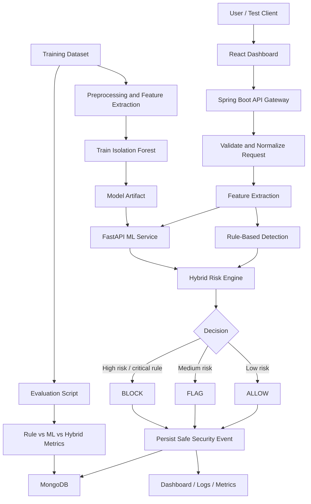
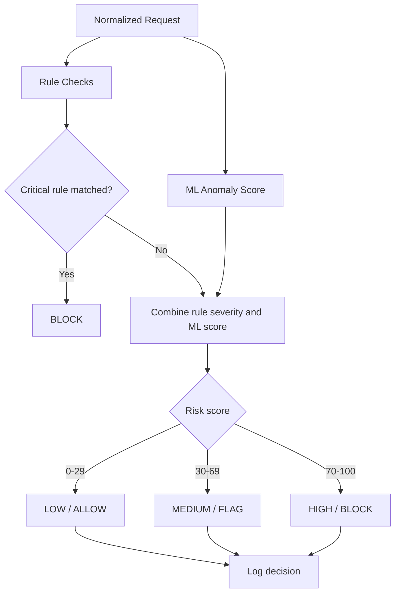
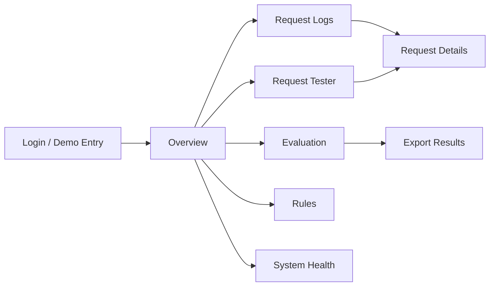

# Application Flow
## AI-Powered Web API Security Gateway

## 1. Overall System Flow

## 2. Request Analysis Flow

1. Tester opens **Request Tester**.
2. Tester chooses a method and enters a path, query, optional safe headers, and optional body.
3. Frontend validates basic required fields and sends the request description to `POST /api/v1/analyze`.
4. Gateway validates sizes and input types.
5. Gateway extracts the versioned numerical feature vector.
6. Rule engine evaluates known suspicious patterns and request-rate rules.
7. Gateway calls the FastAPI model service with the feature vector.
8. Hybrid engine calculates risk and selects `ALLOW`, `FLAG`, or `BLOCK`.
9. Gateway persists a sanitized event and timing data.
10. Frontend displays the result and links to its request detail/log entry.
11. If a real proxy demonstration is enabled, only `ALLOW` requests may be forwarded to the fixed local demo upstream. The request tester must not forward to arbitrary URLs.

## 3. Risk Decision Flow

The score ranges are initial defaults only. Keep thresholds configurable and calibrate them with validation data before research claims. If the ML service is unavailable, record the degraded state and follow the documented fallback policy.

## 4. Dashboard Navigation Flow

## 5. Screen-by-Screen Flow

- **Login / Demo Entry:** authenticate if admin login is included; otherwise enter the local demo dashboard with a clear “Local demo” label.
- **Overview:** view counts and trends; shortcuts open logs, tester, evaluation, or health.
- **Request Tester:** submit a request description; show analysis progress and result.
- **Request Logs:** filter, search, sort, paginate; select a row to open details.
- **Request Details:** inspect decision, score, matched rules, ML status, timings, and sanitized metadata.
- **Evaluation:** compare three approaches and export computed results.
- **Rules:** view rule descriptions and, if protected admin control is implemented, toggle rules.
- **System Health:** view gateway, ML model/service, and database health plus current configuration.
- **Not Found / Error:** show a helpful explanation and a route back to Overview.
